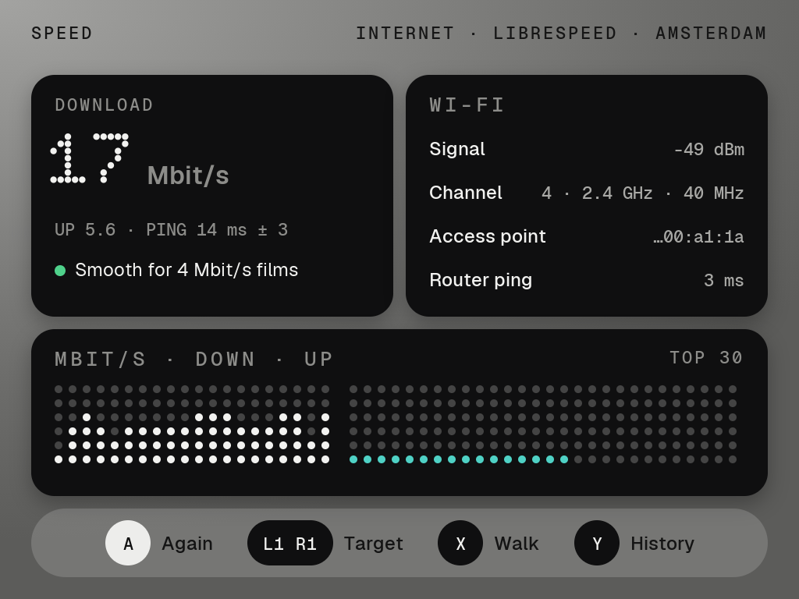
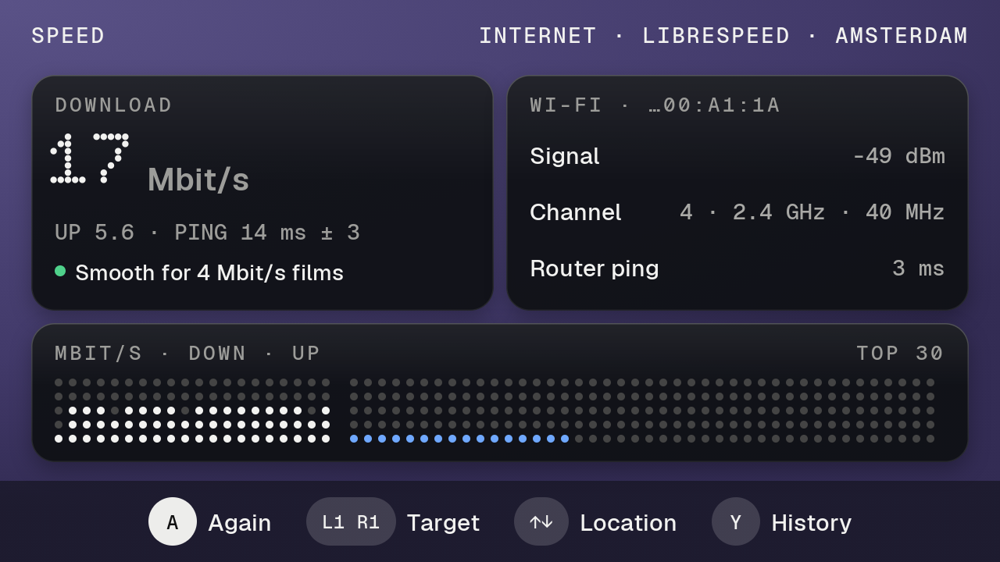
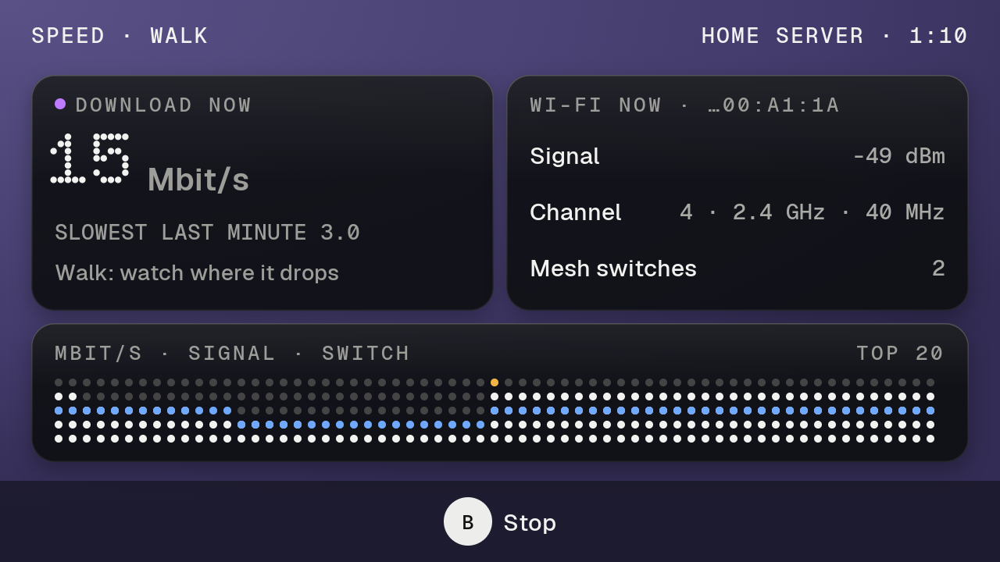

# Speed

How fast the Wi-Fi of a TrimUI Brick or Smart Pro really is: a speed test for [NextUI](https://github.com/LoveRetro/NextUI),
drawn in [Dot](https://github.com/evolver79/nextui-dotui), the shared look of Kino, Musicdisk and Tuner.

Tested on the TrimUI Brick and the TrimUI Smart Pro (both `tg5040`); each gets the layout for its own screen. On the
Smart Pro:

The Brick's 2.4 GHz Wi-Fi can show a strong signal and still not keep up with a film. Speed measures what gets through.

- **Test**: ping, then 10 s of download and 8 s of upload over four connections, drawn second by second as a dot
  graph, with what the slowest second means for films in Kino ("Smooth for 4 Mbit/s films").
- **Walk** (X, against the Home server): keeps downloading while you move around the house. Speed and signal every second, and a lit dot when the
  Brick switches to another mesh point. Shows where the Wi-Fi gives out.
- **History** (Y): the last 100 runs, with target, ping, signal, channel and access point.
- The Wi-Fi card: signal, channel and width, which access point (on a mesh: which point), and the ping to the router,
  which is the Wi-Fi hop on its own.

## Targets (L1 / R1)

| | |
|---|---|
| **Internet** | [LibreSpeed](https://github.com/librespeed/speedtest) (open source): of its public servers, the one that answers quickest (a server that is down is skipped), or one you pick with Up/Down; the choice is kept in `.userdata/tg5040/Speed/location.txt`. Is the line slow, or the Wi-Fi? |
| **Home server** | `tools/speed-server.py` on any PC (Python 3, nothing to install): download and upload on the home network. Put `server=http://<PC's IP>:8080` in `.userdata/tg5040/Speed/speed.txt` on the SD card. |

## Buttons

| | |
|---|---|
| A | Test (again) |
| L1 / R1 | Target |
| Up / Down | Location (Internet): Auto, or a LibreSpeed server, nearest first |
| X | Walk (Home server) |
| Y | History |
| B | Stop; quit |

## Building

`build/build.sh` builds `build/out/speed` in an ARM64 Debian bullseye container (Docker); mbedTLS is built from source
as a static library. `build/shots.sh` renders every screen headless into `build/out/shots/` (the Smart Pro's
with `DOT_SCREEN=1280x720 build/shots.sh`). `deploy.sh` copies it to a
Brick. Over SSH, `./speed <userdata> . --cli internet` runs one test without a screen.

## Licence

MIT. Dot's fonts (Doto, Geist) are under the SIL Open Font License; mbedTLS under Apache 2.0; cJSON under MIT; the CA
list is Mozilla's (MPL 2.0), from curl.se.
